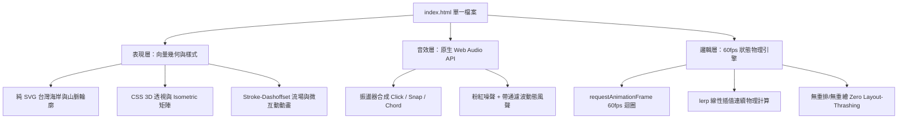

# 颱風對台灣影響：3D / 向量互動視覺化工作台 —— 全方位技術學習指南與實戰解析

本指南針對 [`index.html`](file:///c:/Users/User/Desktop/test/index.html) 所採用的前端核心架構、物理動力學模型與原生多媒體技術進行完整拆解，提供由淺入深的系統性學習路徑與進階實戰題目。

---

## 目錄
1. [專案核心架構總覽](#1-專案核心架構總覽)
2. [學習方向一：高級 SVG 向量幾何與動態路徑工程](#學習方向一高級-svg-向量幾何與動態路徑工程)
3. [學習方向二：CSS 3D 透視空間與物理彈簧動效](#學習方向二css-3d-透視空間與物理彈簧動效)
4. [學習方向三：原生 Web Audio API 程序化聲音設計](#學習方向三原生-web-audio-api-程序化聲音設計)
5. [學習方向四：高效能 60 FPS 動態渲染與物理狀態機](#學習方向四高效能-60-fps-動態渲染與物理狀態機)
6. [學習方向五：台灣地形氣象動力學與地理視覺化](#學習方向五台灣地形氣象動力學與地理視覺化)
7. [階梯式進階實戰練習題庫](#7-階梯式進階實戰練習題庫)

---

## 1. 專案核心架構總覽

在 [`index.html`](file:///c:/Users/User/Desktop/test/index.html) 中，整個系統被設計為**單一檔案純原生封裝**（Zero-Dependency Architecture），無需安裝任何 Node.js 依賴或編譯打包流程，其內部三大主軸為：



---

## 學習方向一：高級 SVG 向量幾何與動態路徑工程

### 核心理論與概念
1. **三次方貝茲曲線（Cubic Bézier Curves）**：
   * 在 SVG 裡，`<path d="M x y C x1 y1, x2 y2, x y" />` 是繪製非規則自然地形（如台灣島嶼海岸線與中央山脈稜線）的核心語法。
   * 控制點 $(x_1, y_1)$ 與 $(x_2, y_2)$ 決定了進入與離開端點的切線方向和曲率張力。
2. **Stroke-Dashoffset 動態流場與描邊原理**：
   * `stroke-dasharray`: 定義虛線段與空白間隔的長度比例（例如 `16 8`）。
   * `stroke-dashoffset`: 定義虛線起始位置的偏移量。
   * **風場流動動畫**：透過負數持續遞減的 offset，可營造出流體粒子沿著封閉或開放路徑無限運動的視覺錯覺。
3. **向量濾鏡管線（SVG Filter Graph）**：
   * `<filter>` 元素允許在向量層級進行即時後製處理。
   * 本專案中使用 `<feGaussianBlur>` 產生模糊輝光，搭配 `<feMerge>` 將發光層與原始向量圖元（SourceGraphic）疊加，達成低功耗的科技感光暈。

### 關鍵代碼範例（參考專案代碼）
```css
/* 氣旋逆時針流線循環動畫 */
.wind-streamline {
  fill: none;
  stroke: rgba(56, 189, 248, 0.5);
  stroke-width: 1.5;
  stroke-linecap: round;
  stroke-dasharray: 16 8;
  animation: wind-flow 1.6s linear infinite;
}

@keyframes wind-flow {
  to {
    stroke-dashoffset: -48; /* 往逆時針方向平移一個完整週期 */
  }
}
```

### 延伸研究主題
* 探索向量等高線（Contour Lines）在地理資訊視覺化中的插值算法（Marching Squares 演算法）。
* 深入 SVG SMIL 與 CSS Web Animations API (WAAPI) 在複雜幾何變形（Path Morphing）上的效能對比。

---

## 學習方向二：CSS 3D 透視空間與物理彈簧動效

### 核心理論與概念
1. **CSS 3D 變換層級模型**：
   * **視距（Perspective）**：父容器定義 `perspective: 1400px`，決定人眼視點與 $Z=0$ 平面的距離。
   * **空間保持（preserve-3d）**：子元素宣告 `transform-style: preserve-3d`，使內部的 SVG 與子節點保持在真正的三維幾何空間內，而非被壓平為 2D 點陣紋理。
   * **等角投影（Isometric 3D）**：藉由組合 `rotateX(54deg) rotateZ(-32deg)`，可呈現經典的 2.5D 工程等角俯瞰視角。
2. **彈簧超調緩動（Spring Overshoot Easing）**：
   * 標準線性或 ease-in-out 動畫缺乏機械與自然界的動能回饋。
   * 本專案使用的 `cubic-bezier(0.34, 1.56, 0.64, 1)` 其第三點超越了 1.0，會在抵達目標值前產生瞬間的物理彈跳（Overshoot & Settle），大幅提升觸控回饋感。

### 關鍵代碼範例
```css
/* 視角切換器之 3D 矩陣配置 */
.viewport-3d-wrapper {
  transform-style: preserve-3d;
  transition: transform 0.8s cubic-bezier(0.16, 1, 0.3, 1);
}

/* 2D 平面俯視 */
.viewport-3d-wrapper.view-2d {
  transform: rotateX(0deg) rotateZ(0deg) scale(1);
}

/* 3D 等角透視 (中央山脈立體凸起) */
.viewport-3d-wrapper.view-isometric {
  transform: rotateX(54deg) rotateZ(-32deg) scale(0.96) translateZ(30px);
}
```

---

## 學習方向三：原生 Web Audio API 程序化聲音設計

### 核心理論與概念
1. **無依賴合成架構**：
   * 杜絕傳統 `.mp3` / `.wav` 外部資源帶來的網路延遲、載入失敗與快取失效問題。
   * 使用瀏覽器原生的 `AudioContext`，由數學公式在毫秒內即時計算波形輸出。
2. **ADSR 包絡線與頻率指數衰減**：
   * **Click（點擊音）**：正弦波在 40ms 內由 1400Hz 指數跳降至 350Hz，產生清脆短促的音效。
   * **Snap（吸附音）**：三角波在 25ms 內由 520Hz 降至 180Hz，呈現機械齒輪卡榫的沈穩回饋。
   * **Chord（和弦音）**：利用五度圈頻率陣列（523.25Hz, 659.25Hz, 783.99Hz, 1046.50Hz）分段微延遲觸發，合成豐潤的和弦琶音。
3. **程序化粉紅噪聲（Pink Noise）與風聲調製**：
   * **白噪聲 vs 粉紅噪聲**：白噪聲在各頻段能量均等（聽感刺耳如電視雪花）；粉紅噪聲功率譜密度隨頻率反比遞減（$1/f$），更貼近自然界中的狂風風聲。
   * **帶通動態濾波（BiquadFilterNode）**：透過調節 `bandpass` 的中心頻率與 $Q$ 因子，隨著颱風風速提高（$25\text{ m/s} \to 55\text{ m/s}$），動態將濾波頻率由 220Hz 向上推升至 700Hz，營造疾風呼嘯的臨場感。

### 核心合成演算法
```javascript
// 利用 Paul Kellet 濾波演算法在 AudioBuffer 中生成 2 秒無縫粉紅噪聲迴圈
const bufferSize = audioCtx.sampleRate * 2;
const noiseBuffer = audioCtx.createBuffer(1, bufferSize, audioCtx.sampleRate);
const output = noiseBuffer.getChannelData(0);
let b0 = 0, b1 = 0, b2 = 0, b3 = 0, b4 = 0, b5 = 0, b6 = 0;

for (let i = 0; i < bufferSize; i++) {
  const white = Math.random() * 2 - 1;
  b0 = 0.99886 * b0 + white * 0.0555179;
  b1 = 0.99332 * b1 + white * 0.0750759;
  b2 = 0.96900 * b2 + white * 0.1538520;
  b3 = 0.86650 * b3 + white * 0.3104856;
  b4 = 0.55000 * b4 + white * 0.5329522;
  b5 = -0.7616 * b5 - white * 0.0168980;
  output[i] = (b0 + b1 + b2 + b3 + b4 + b5 + b6 + white * 0.5362) * 0.06;
  b6 = white * 0.115926;
}
```

---

## 學習方向四：高效能 60 FPS 動態渲染與物理狀態機

### 核心理論與概念
1. **防止 Layout Thrashing（佈局顛簸）**：
   * 瀏覽器重排（Reflow）是效能最大殺手。
   * 在 60 FPS `requestAnimationFrame` 迴圈中，**嚴禁交替讀寫 DOM 佈局屬性**（如讀取 `clientWidth` 後又設定 `style.left`）。
   * 本專案全數採用 GPU 獨立圖層合成屬性：`transform`（平移/旋轉/縮放）與 `opacity`（淡入淡出），確保每幀消耗低於 16.6ms。
2. **連續線性插值（Linear Interpolation - `lerp`）**：
   * 當時間軸滑桿處於任意數值（如進度 54.2%）時，狀態機在相鄰的兩個離散物理錨點之間進行平滑插值：
     $$\text{val}(t) = \text{start} + (\text{end} - \text{start}) \times t \quad (t \in [0, 1])$$
   * 應用範圍：颱風中心經緯度座標、中心氣壓、瞬間風速、降雨量及背風側測站溫度。

---

## 學習方向五：台灣地形氣象動力學與地理視覺化

### 核心科學原理
1. **中央山脈（護國神山）的氣動力屏障**：
   * 台灣中央山脈平均標高超過 3000 公尺（最高峰玉山達 3952 公尺），垂直厚度貫穿了大氣對流層下半部，對西太平洋移入的熱帶氣旋形成不可忽視的剛性地形阻擋。
2. **迎風面極端地形雨（Orographic Rain）**：
   * 暖濕熱帶氣流遇山脈被迫急遽抬升，以**濕絕熱遞減率（Moist Adiabatic Lapse Rate, $\approx 0.6^\circ\text{C}/100\text{m}$）**降溫達到水氣飽和，釋放龐大潛熱並凝結為暴雨（如花蓮、宜蘭或阿里山地區）。
3. **背風面焚風現象（Foehn Effect）**：
   * 空氣越嶺過程中水氣凝結降水析出，翻過 3000m 山脊後變成相對乾燥空氣。
   * 沿著背風坡下沉時，以**乾絕熱遞減率（Dry Adiabatic Lapse Rate, $\approx 1.0^\circ\text{C}/100\text{m}$）**急遽壓縮增溫，形成高溫乾燥強風（常導致新竹、苗栗、台中或台東出現 $36^\circ\text{C} \sim 38^\circ\text{C}$ 異常高溫）。
4. **低層環流切變與副低壓分裂（Secondary Vortex）**：
   * 颱風低層環流撞擊山脈時被強行切斷摩擦減弱，但中高層渦度仍繼續前進；同時繞過台灣南北兩端的氣流常在台灣海峽背風側誘發副低壓中心，造成氣象雷達上中心「跳躍過山」的特殊現象。
5. **西南氣流引流共伴（Southwesterly Monsoon Inflow）**：
   * 颱風過境出海移至台灣海峽北部後，其逆時針旋轉環流拖曳西南季風直衝台灣西南部山區，往往在颱風遠離後造成持續數日的中南部災難性降雨（典型如 2009 年莫拉克颱風）。

---

## 7. 階梯式進階實戰練習題庫

### 🟢 基礎級（Level 1：樣式與互動調校）
* [ ] **練習 1-1**：在頂部 HUD 狀態列新增「日夜模式切換（Day/Night Mode）」，將深藍色背景平滑漸變為高對比白天的航海氣象地圖風格。
* [ ] **練習 1-2**：修改 CSS 彈簧曲線，為側邊欄面板新增折疊/展開動畫，並套用 `transform: translateX(-100%)` 與回彈效果。

### 🟡 中階級（Level 2：音訊與物理擴充）
* [ ] **練習 2-1**：在 `AudioSynthesisEngine` 中新增一個「雷暴閃電（Thunder）合成器」，利用低頻方波（Square wave）結合低通濾波器與短暫隨機脈衝，模擬雷聲滾滾。
* [ ] **練習 2-2**：當累積降雨量超過 600mm 時，在 SVG 畫布中動態生成隨機閃電折線（Lightning Bolt），並觸發畫布亮白瞬間重繪。
* [ ] **練習 2-3**：在右側面板新增一個由純 SVG 弧線構成的「圓形風速指針表（Analog Gauge Meter）」，隨風速即時旋轉。

### 🔴 高階級（Level 3：架構與數據實踐）
* [ ] **練習 3-1**：將原本硬編碼的 `STAGES_DATA` 物理階段抽取出來，實作一個支援從外部讀取真實 GeoJSON 氣象歷史觀測點（如氣象署開放資料）的解譯模組。
* [ ] **練習 3-2**：利用 WebGL 或純 2D Canvas 的 `getImageData` 實作真正的「流線粒子流動場（Wind Particle Streamlines）」，在維持 60 FPS 的前提下渲染 2000 顆依氣壓梯度旋轉運動的風力粒子。
* [ ] **練習 3-3**：支援透過 `HTMLCanvasElement.captureStream()` 與 Web Audio API 的 `createMediaStreamDestination()`，達成一鍵錄製 10 秒包含動態畫面與合成音效的 `.webm` 影片檔匯出功能。

---

> **檔案關聯指引**：
> * 執行與體驗應用程式：請直接於瀏覽器打開 [`index.html`](file:///c:/Users/User/Desktop/test/index.html)。
> * 本學習手冊檔案：[`LEARNING_GUIDE.md`](file:///c:/Users/User/Desktop/test/LEARNING_GUIDE.md)。
